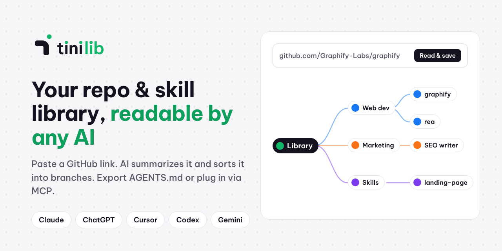

<p align="center"></p>

<p align="center"><b>A repo & skill library that any AI can use.</b><br>
Save the GitHub repos and AI skills you collect, let AI summarize and sort them into branches, then export one file that Claude, ChatGPT, Cursor, Codex and others can read.</p>

<p align="center"><a href="README.vi.md">Tiếng Việt</a> · <a href="https://tvtinhofficial.github.io/tini-library/">Live demo</a></p>

---

## Why

If you use AI tools a lot, you end up with dozens of starred repos, skills and prompts scattered everywhere. Bookmarks save them, but your AI assistant never knows they exist. tinilib keeps them in one `library.json` and turns it into an `AGENTS.md` your AI reads before it starts building from scratch.

## Features

- **Paste a GitHub link, done.** The app fetches the README and stars through the GitHub API.
- **Skills and other tools too.** Paste or upload `SKILL.md` files (Claude skills, or any instruction file), or save any link such as Canva or Notion.
- **Your own branches.** Start with Web dev / Marketing / Other, then add branches for your field (Design, AI video, Accounting…). With AI on, new items are sorted automatically, and AI proposes a new branch when nothing fits.
- **AI summary with your own key.** Works with OpenAI, Anthropic (Claude), Google Gemini, Ollama (fully local, free) or any OpenAI-compatible API (OpenRouter, Groq, LM Studio). No key? It still saves the repo with GitHub's own description.
- **List or map.** A compact list with a detail panel, or a map: Library → branches → groups → tools.
- **Export for any AI.** `AGENTS.md`, `llms.txt` or `library.json`, to copy or download.
- **Your data stays with you.** No server, no account. Data and API keys live in your browser; the library is a plain JSON file you can commit.
- **Vietnamese and English** interface.

## Quick start

**Option A — use it online:** open the live demo, add repos, export.

**Option B — run it locally (recommended for your own library):**

```bash
git clone https://github.com/tvtinhofficial/tini-library
cd tini-library
npx serve .        # or: python3 -m http.server 8000
```

Open the address it prints. Opening `index.html` directly also works, but then the bundled `library.json` will not load (browsers block that on `file://`); use **Settings → Import file** instead.

To turn on AI summaries: **Settings → AI provider**, then paste your key and pick a model. For Ollama, start it with `OLLAMA_ORIGINS=*` so the browser may call it.

## Using your library with AI tools

| Tool | How |
| --- | --- |
| Cursor, Claude Code, Codex, Gemini CLI, Copilot | Export `AGENTS.md` and put it in the root of your project (Claude Code also reads it if you rename or copy it to `CLAUDE.md`). |
| ChatGPT, Claude (web/app), Gemini | Export and paste `AGENTS.md` into the chat, or add it to a Project / custom GPT as a file. |
| Anything else | `llms.txt` is a short list; `library.json` has every field. |
| **Live search (MCP)** | Run the [MCP server](mcp/) and Claude Desktop, Claude Code, Cursor or ChatGPT can search your library directly — no file pasting. |

Rebuild the files from the command line after editing `library.json`:

```bash
node scripts/build-agents.mjs            # writes AGENTS.md and llms.txt
node scripts/scan-skills.mjs             # adds your ~/.claude/skills to library.json
```

## Data format

```json
{ "version": 2,
  "branches": [ { "id": "web", "name": "Web dev", "color": "#1877F2" } ],
  "items": [ {
  "id": "owner-repo", "type": "repo | skill | tool", "name": "owner/repo",
  "url": "https://github.com/owner/repo", "cat": "<branch id>",
  "group": "Sub-group", "icon": "lucide-icon-name",
  "desc": "...", "points": ["..."], "when": "...", "install": "...", "prompt": "...",
  "body": "full SKILL.md text (skills only)"
} ] }
```

## Roadmap

- [x] MCP server so ChatGPT and Claude can search the library live
- [ ] Hosted MCP (no tunnel needed)
- [x] Custom branches for any field
- [ ] Import from GitHub stars

## Changelog

See [CHANGELOG.md](CHANGELOG.md). Latest: AI requests time out after 90 s with a Cancel button, faster Gemini 3.x (low thinking), shorter input.

## Privacy

API keys are stored in your browser's localStorage and sent only to the provider you choose. On a shared computer, clear them in Settings after use.

## License

MIT · made by [tinihub](https://tinifb.net)
